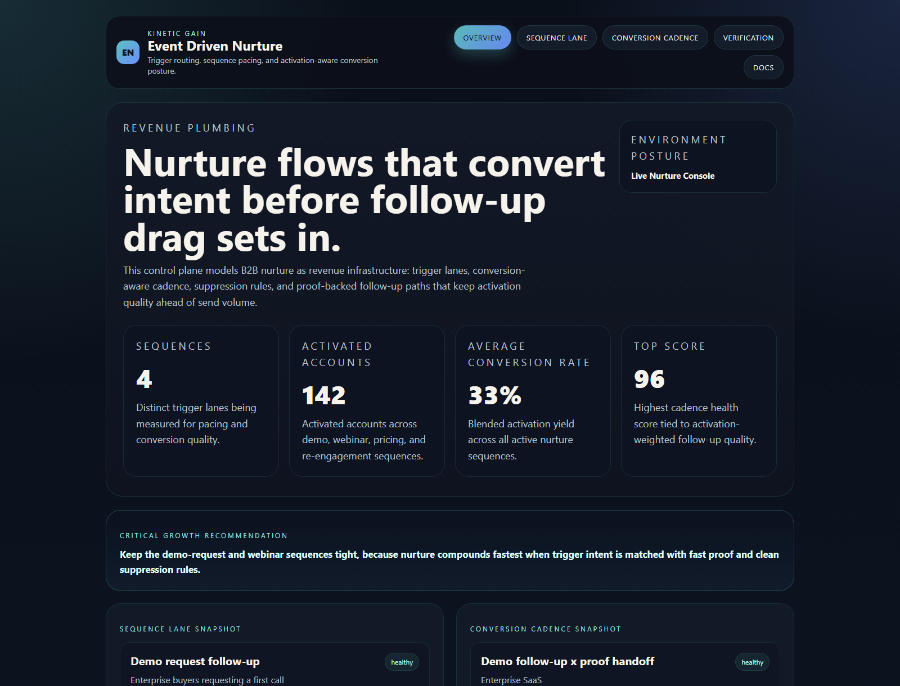

# event-driven-nurture

Board-ready Kinetic Gain surface for event-driven nurture sequencing, conversion pacing, and activation-aware follow-up loops that keep downstream pipeline quality ahead of vanity send volume.

- Live: [http://nurture.kineticgain.com/](http://nurture.kineticgain.com/)
- Repo: [https://github.com/mizcausevic-dev/event-driven-nurture](https://github.com/mizcausevic-dev/event-driven-nurture)

## Why this matters

Leaders need one nurture surface that shows which trigger paths are converting, which follow-up cadences are stalling, and where activation pressure should move before the next revenue push.

## What it includes

- TypeScript control plane for event-driven nurture sequencing, trigger routing, follow-up pacing, and activation-aware conversion loops
- synthetic nurture cohorts across signup, webinar, sales-assist, and re-engagement lanes
- reusable outputs for trigger pacing, sequence posture, follow-up assets, and board-facing pipeline narratives
- prerendered static site, JSON payloads, screenshots, and docs

## Routes

- `/`
- `/sequence-lane`
- `/conversion-cadence`
- `/verification`
- `/docs`

## Local run

```powershell
cd event-driven-nurture
npm install
npm run verify
npm run prerender
npm run render:assets
```

## CLI

```powershell
npm run demo
npm run smoke
```

## Docs

- [docs/architecture.md](./docs/architecture.md)
- [docs/incentive-notes.md](./docs/incentive-notes.md)
- [docs/ORIGIN.md](./docs/ORIGIN.md)

## Screenshots




